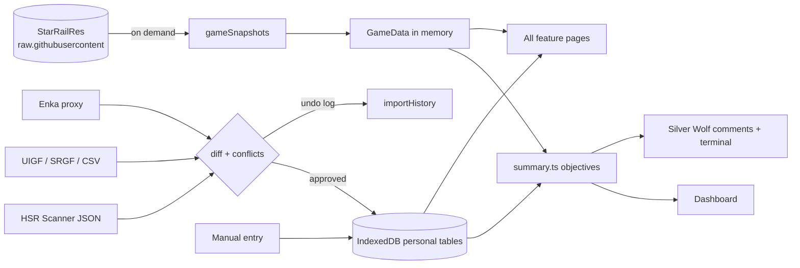
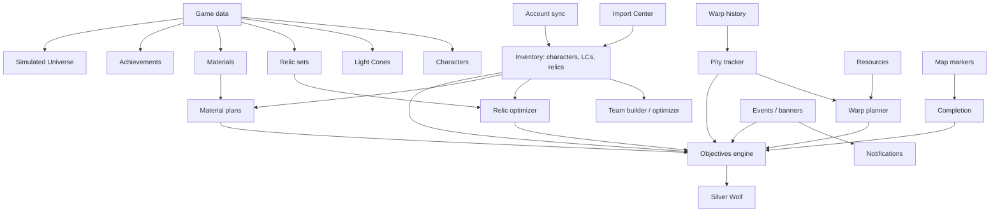

# 01 · Technical architecture

## Environment inspected (2026-11-25)

Empty working directory, Node 22.23, pnpm 10.28, Chromium + Playwright 1.63 pre-installed. Outbound network: npm registry and raw.githubusercontent.com reachable; enka.network, HoYoLAB, fandom, Prydwen and Star Rail Station blocked in the development sandbox (they are reachable from a normal home network).

## Stack

| Layer | Choice | Why |
| --- | --- | --- |
| Framework | Next.js 15 (App Router), React 19, TypeScript strict | As requested; static pages + one server route |
| Styling | Tailwind CSS 4, custom theme tokens in `globals.css` | Fast, consistent design system |
| Motion | Framer Motion | Speech bubbles, Warp reveals; respects reduced motion |
| Storage | IndexedDB via Dexie 4 + `dexie-react-hooks` | Local-first, offline, live queries (ADR-1) |
| Validation | Zod 4 | Every import and download is schema-checked |
| Charts | Recharts 3 | Pity distribution, probability curves, endgame history |
| State | Zustand (app shell: settings, active profile, game data) | Tiny; personal data stays in IndexedDB |
| Tests | Vitest 3 (+ fake-indexeddb), Playwright 1.63 | Unit + end-to-end |

## Architecture decisions (ADRs)

**ADR-1 · IndexedDB is the system of record (approved by you).** The brief recommended SQLite plus IndexedDB; you chose IndexedDB only. All personal data lives in Dexie tables in the browser. Every page reads through live queries, so all systems share one database and update together. SQLite/Postgres sync can be added later behind the same table shapes.

**ADR-2 · Game data is downloaded on demand, never bundled (approved by you).** StarRailRes (AGPL-3.0, HoYoverse content) is fetched by the browser into a `gameSnapshots` table. The repository contains no game data or art. Snapshots are versioned; the three newest are kept for rollback.

**ADR-3 · Personality is separate from facts.** Silver Wolf's lines are templates filled only with values computed from data. Every comment carries a `facts[]` list. The terminal answers through deterministic intents over local data and returns `sources[]`. An external LLM is optional future work that needs your approval.

**ADR-4 · Honest modules over fabricated ones.** Where no licensed or reachable source exists (bosses, missions, banners, map markers, community builds), the module is a structured manual system with source links and confirmed/speculation/leak status instead of invented data.

**ADR-5 · Published rules vs community models.** Warp base rates, hard pity and guarantees come from the in-game details pages. Soft pity is a community model, labelled as such, and calibrated so that its consolidated rate reproduces the published rate; tests enforce this.

**ADR-6 · One server route.** `/api/enka/[uid]` exists only because Enka needs a User-Agent and has no CORS. Everything else works from static pages.

**ADR-7 · Enhanced kits.** StarRailRes lists both original and enhanced kits for some characters (ids prefixed `1`). Costs use one kit (`kitTrees(c, "original")`); the UI can switch views. Without this, costs for 10 characters would be doubled.

## Folder structure

```
src/
  app/                    one folder per page (19 areas + status) and api/enka/[uid]
  components/             Shell, SilverWolf, GameImage, Codex, RelicCard, CharacterEditor, warp/*
  lib/
    db.ts                 Dexie schema (v2), helpers
    store.ts              app shell state (settings, profile, game data)
    hooks.ts              live account summary, offsets, relic profiles
    summary.ts            objectives engine (dashboard + Silver Wolf)
    gamedata/             source download/validation, types, stats helpers, kits
    warp/                 rules, exact probability, simulator + Monte Carlo, history, planner
    relics/               stat vocabulary, roll tables, scoring profiles
    materials/            cost calculator, character/Light Cone plans
    importers/            HSR Scanner, UIGF/SRGF/CSV, keyed diff, apply + rollback
    connectors/enka.ts    capability registry + showcase parser
    companion/            voice (line banks), comments (data → line), terminal (intents)
    teams.ts map.ts time.ts markdown.ts backup.ts status.ts types.ts
  test/setup.ts
tests/e2e/                Playwright specs + synthetic game data fixtures
docs/                     this documentation
```

## Data flow



## Feature dependency diagram


